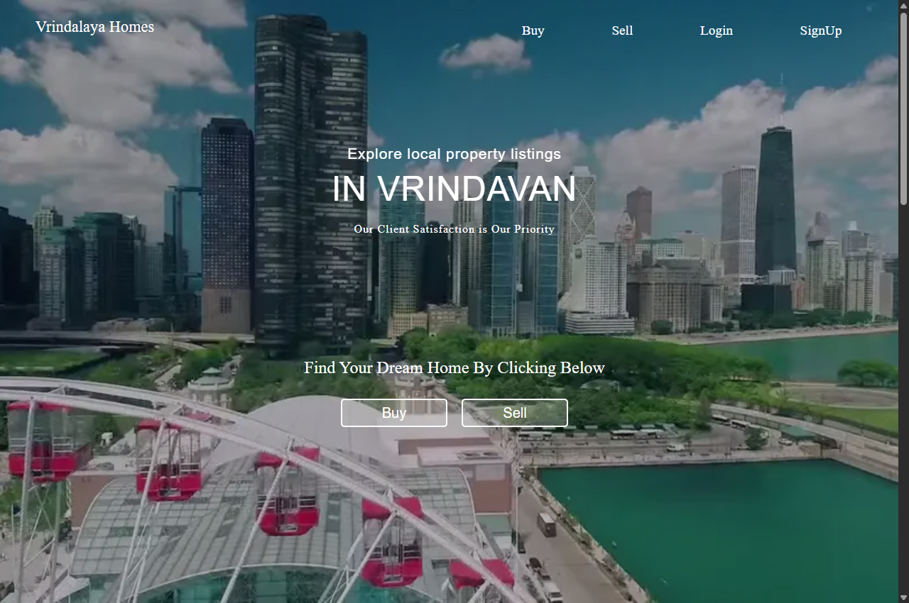
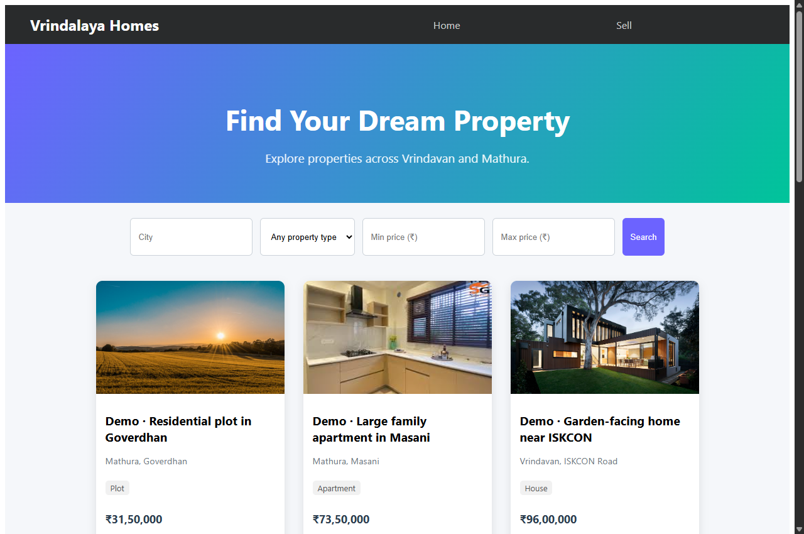
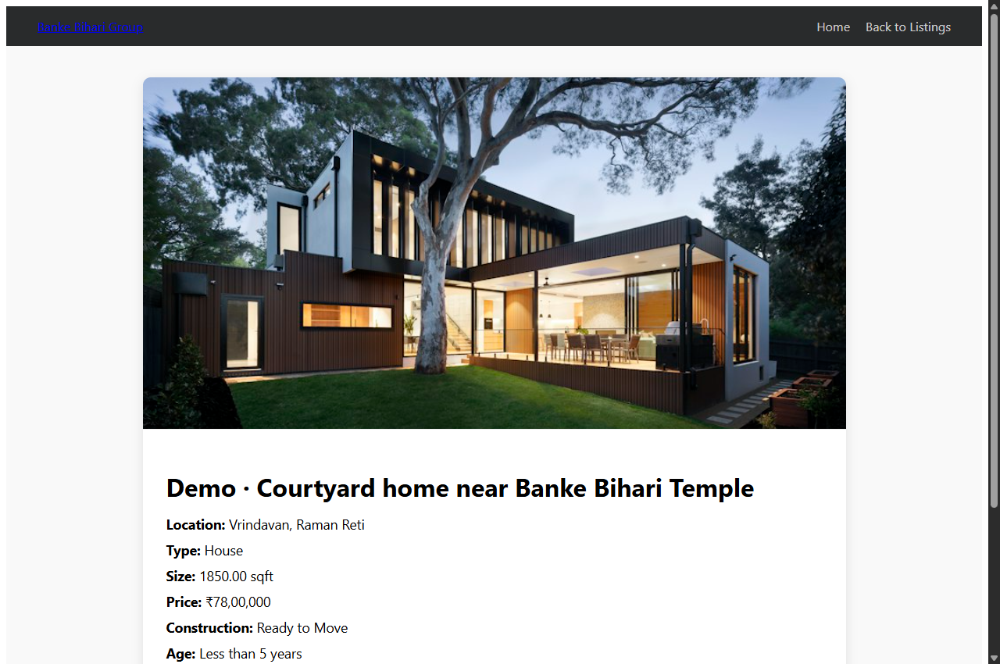
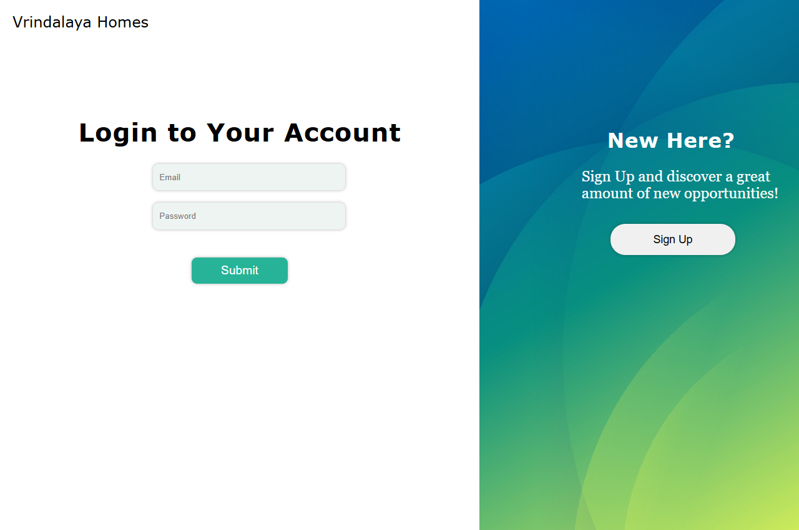
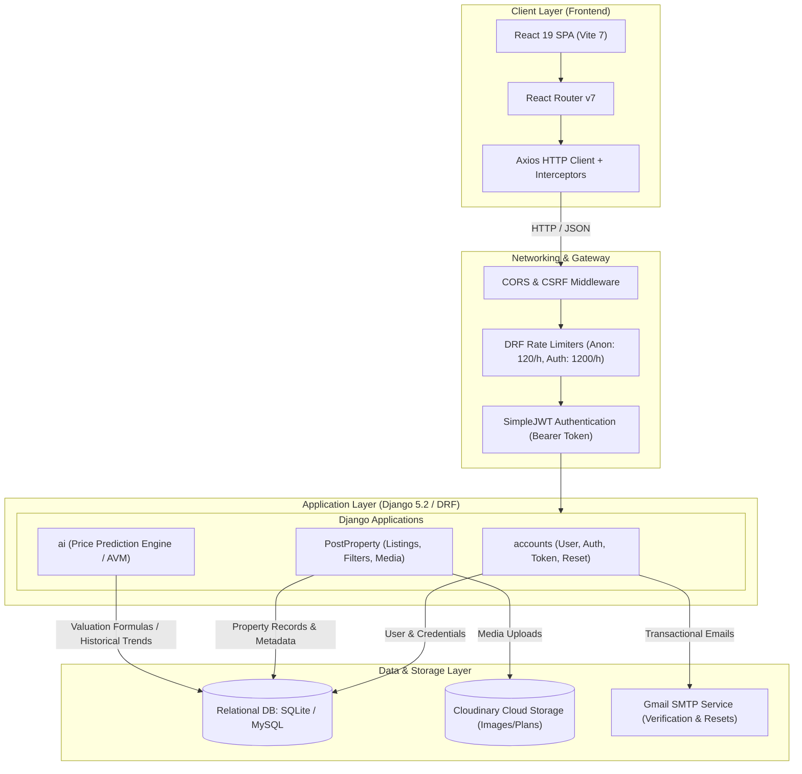
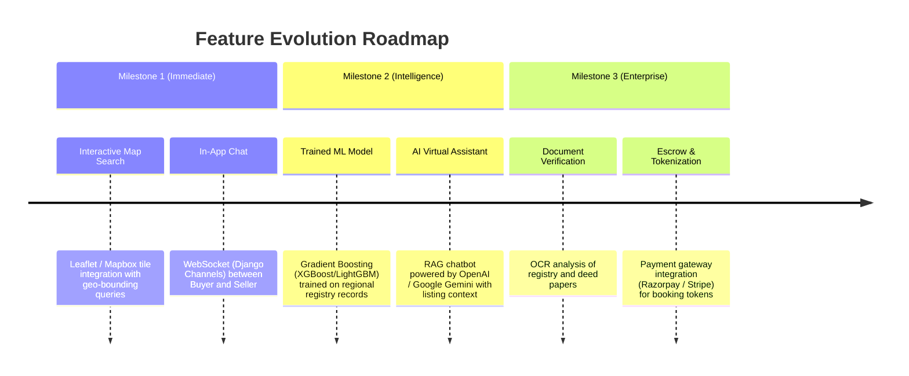

# 🏡 Vrindalaya Homes — Modern AI-Driven Real Estate Platform

> *"Find Your Sanctuary in the Holy City."*

<p align="center">
  
  
  
  
  
  
  
</p>

---

## 📖 Executive Summary

The **Vrindalaya Homes Real Estate Platform** is a full-stack, production-engineered real estate web application designed specifically for property discovery, valuation, and listing management in the Vrindavan–Mathura pilgrimage & residential corridor (Uttar Pradesh, India).

The system pairs a **React 19 single-page client** with a robust **Django REST Framework (DRF)** backend, offering:
- Multi-tier JWT token authentication with email verification.
- Controlled 5-step seller listing onboarding with administrative moderation workflows.
- Public property inventory search with multi-parameter filtering and pagination.
- **AI-assisted automated valuation model (AVM)** for real-time market price estimation.
- Comprehensive end-to-end test coverage across both frontend (Vitest + JSDOM) and backend (Pytest + Django Test Runner).

---

## 📸 Application Previews & Screenshots

<p align="center">
  <b>🌐 Hero Landing Page</b>
  <br>
  
</p>

<p align="center">
  <b>🔍 Property Catalog & Search with Filter Controls</b>
  <br>
  
</p>

<table align="center" width="100%">
  <tr>
    <td align="center" width="50%">
      <b>🏡 Property Detail & Specifications</b><br>
      
    </td>
    <td align="center" width="50%">
      <b>🔐 Secure Authentication Portal</b><br>
      
    </td>
  </tr>
</table>

---

## 🏛️ High-Level System Architecture



### Component Details
1. **Frontend (Presentation Tier)**:
   - React 19 with route-level code splitting (`React.lazy` & `Suspense`).
   - Clean separation of concerns between authentication contexts, authenticated routes (`RequireAuth`), listing workflows, and public search.
2. **Backend (Application Tier)**:
   - Stateless REST API protected by JSON Web Tokens (`access` + auto-rotated `refresh` with blacklisting).
   - Granular authorization gates: Public access for browsing, verified user tokens required for publishing, admin moderation required before listings go live.
3. **AI Valuation Micro-Engine**:
   - Accepts geospatial coordinates, structural characteristics, property age, furnishing grade, and size.
   - Calculates baseline property valuations and market range bands (`min`, `max`, `confidence`).

---

## 🛠️ Tech Stack & Tooling

| Component | Technology | Rationale |
| :--- | :--- | :--- |
| **Frontend Framework** | React 19 + Vite 7 | Lightning-fast HMR builds, concurrent rendering capabilities |
| **Routing** | React Router v7 | Dynamic client-side routing with guarded access controls |
| **Backend API** | Django 5.2 + Django REST Framework | Batteries-included, ORM safety, built-in validation & admin tooling |
| **Authentication** | SimpleJWT (`djangorestframework-simplejwt`) | Secure token rotation, zero server-session storage bottleneck |
| **Package Management** | `uv` (Python) & `npm` (Node) | `uv` delivers 10–100x faster virtual environment and lockfile resolution |
| **Database** | SQLite (Dev) / MySQL or PostgreSQL (Prod) | Configurable via environment engine toggle (`DB_ENGINE`) |
| **Media Management** | Cloudinary & `django-cloudinary-storage` | Offloaded image resizing, optimization, and reliable CDN delivery |
| **Backend Testing** | `pytest`, `pytest-django`, Django `APITestCase` | Fast, fixture-driven testing for endpoints and model invariants |
| **Frontend Testing** | `vitest`, `@testing-library/react`, `jsdom` | Native Vite integration with full DOM emulation |
| **Containerization** | Docker & Docker Compose | Multi-container reproducible environments |

---

## 📂 Repository Directory Layout

```text
Real-Estate/
├── docker-compose.yml              # Multi-container orchestration (Web + Frontend + DB)
├── README.md                       # Comprehensive project documentation
│
├── Backend/                        # Django REST API root
│   ├── pyproject.toml              # Modern Python dependency specifications
│   ├── uv.lock                     # Deterministic dependency lockfile
│   ├── pytest.ini                  # Pytest runner configuration
│   ├── Dockerfile                  # Production container definition for backend
│   └── backend/                    # Django project core
│       ├── manage.py               # Django task runner CLI
│       ├── .env                    # Active local environment variables
│       ├── backend/                # Project configurations (settings, wsgi, urls)
│       ├── accounts/               # Custom user model, token auth, mail tokens
│       ├── PostProperty/           # Property listings, image relations, moderation
│       └── ai/                     # AI valuation engine, serializers, endpoints
│
└── frontend/                       # React client root
    ├── package.json                # Frontend dependencies and run scripts
    ├── vite.config.js              # Vite bundler & Vitest test harness setup
    ├── Dockerfile                  # Container definition for frontend client
    ├── src/
    │   ├── App.jsx                 # Top-level routing & Suspense fallback
    │   ├── setupTests.js           # Vitest environment mocks (JSDOM, matchMedia)
    │   ├── __tests__/              # Automated React component and integration tests
    │   ├── Components/
    │   │   ├── Auth/               # Login, Signup, Password Reset UI
    │   │   ├── Buy/                # Property catalogue, search, details modal
    │   │   ├── Home/               # Landing page, hero showcase, about section
    │   │   └── Sell/               # Multi-step listing onboarding wizard
    │   └── utils/                  # Auth guards, HTTP helpers
```

---

## ⚡ Quick Start & Setup Guide

### Prerequisites
- **Python 3.10+** and [uv](https://docs.astral.sh/uv/) (Recommended) or standard `pip`
- **Node.js 18+** & `npm`
- *(Optional)* Docker Desktop (if running via container orchestration)

---

### 1. Backend Setup

```bash
# Navigate to Backend folder
cd Backend

# Sync Python dependencies using uv
uv sync

# Run database migrations
uv run python backend/manage.py migrate

# (Optional) Seed demo property listings
uv run python backend/manage.py seed_demo

# Start the Django development server (HTTP 127.0.0.1:8000)
uv run python backend/manage.py runserver 127.0.0.1:8000
```

> **Default Superuser**:
> - Email: `admin@example.com`
> - Password: `admin123`
> - Admin URL: `http://localhost:8000/admin`

---

### 2. Frontend Setup

```bash
# Open a new terminal in frontend directory
cd frontend

# Install dependencies
npm install

# Start the Vite development server (http://localhost:5173)
npm run dev
```

---

### 3. Docker Compose (Alternative)

To build and spin up the complete isolated environment:
```bash
docker compose up --build
```

---

## 🔌 Core API Specifications

### 🔐 Authentication (`/api/accounts/`)
| Method | Endpoint | Description | Auth Required |
|:---|:---|:---|:---:|
| `POST` | `/api/accounts/auth/register/` | Register user account & dispatch email verification | No |
| `GET` | `/api/accounts/auth/verify-email/<token>/` | Verify user email token | No |
| `POST` | `/api/accounts/auth/login/` | Authenticate user & return JWT access/refresh pair | No |
| `POST` | `/api/accounts/auth/logout/` | Blacklist current refresh token | Yes |
| `POST` | `/api/accounts/auth/token/refresh/` | Obtain fresh access token via refresh token | No |
| `POST` | `/api/accounts/auth/password-reset/request/` | Trigger reset link to user's registered inbox | No |

### 🏡 Properties (`/api/property/`)
| Method | Endpoint | Description | Auth Required |
|:---|:---|:---|:---:|
| `GET` | `/api/property/buy/` | Paginated search of approved properties (Filters: `city`, `price`, `bedrooms`, etc.) | No |
| `POST` | `/api/property/sell/` | Submit new property for admin verification | Yes |
| `GET` | `/api/property/property/<id>/` | View public specifications of single property | No |
| `GET` | `/api/property/property/<id>/contact/` | Reveal owner contact details (phone, email) | Yes |
| `GET` | `/api/property/mine/` | List all properties submitted by currently logged-in user | Yes |
| `PATCH` | `/api/property/mine/<id>/` | Edit listing (automatically puts status back to 'Under Review') | Yes |
| `POST` | `/api/property/mine/<id>/sold/` | Mark active property as Sold | Yes |

### 🤖 AI Valuation Engine (`/api/ai/`)
| Method | Endpoint | Description | Auth Required |
|:---|:---|:---|:---:|
| `POST` | `/api/ai/predict/` | Automated valuation model calculating predicted property price | No |

#### Sample AI Prediction Request:
```bash
curl -X POST http://127.0.0.1:8000/api/ai/predict/ \
  -H "Content-Type: application/json" \
  -d '{
    "property_type": "House",
    "city": "Vrindavan",
    "locality": "Raman Reti",
    "size_sqft": 1200,
    "bedrooms": 3,
    "bathrooms": 2,
    "age_of_property": "New",
    "furnishing_status": "Semi-Furnished",
    "parking": true
  }'
```

#### Sample AI Prediction Response:
```json
{
  "estimated_price": "6140000.00",
  "confidence": "low",
  "comparable_range": {
    "min": "5219000.00",
    "max": "7061000.00"
  },
  "note": "This is a rule-based stub estimate. A trained ML model will replace this once sufficient listing data is collected."
}
```

---

## 🧪 Automated Testing

Both tiers include dedicated unit and integration testing pipelines to prevent regressions:

### 🐍 Backend Test Suite (Pytest)
```bash
cd Backend
uv run pytest
```
*Current test suite: **17 passed** covering authentication flows, permissions, property boundaries, and AI valuation algorithms.*

### ⚛️ Frontend Test Suite (Vitest)
```bash
cd frontend
npm test
```
*Current test suite: **3 passed** covering route loading fallbacks, navbar actions, and core UI rendering.*

---

## 🚀 Recommended Roadmap & What Needs to Be Included

To transform this platform into an industry-grade, venture-ready real estate ecosystem, we recommend prioritizing the following architectural enhancements:



### 1. Geospatial & Visual Search
- **Interactive Map Search**: Integrate Leaflet / Mapbox with OpenStreetMap layers so users can draw bounding boxes or search by proximity to key landmarks (e.g., Banke Bihari Temple, Prem Mandir, Highway NH-19).
- **Virtual 360° Tours**: Allow sellers to upload equirectangular panorama photos rendered in-browser using Three.js or Pannellum.

### 2. Upgraded AI & Automation Capabilities
- **Trained ML Models**: Replace the rule-based valuation stub with an XGBoost/LightGBM regressor trained on real historical registry deeds and localized sale benchmarks.
- **RAG-Powered AI Property Advisor**: Embed listings in a vector database (e.g., pgvector / Pinecone) and deploy an LLM chatbot capable of answering questions like: *"Which 2-bedroom flats in Raman Reti have parking under ₹50 Lakhs?"*.
- **Computer Vision Quality Check**: Automatically screen uploaded property photos to detect duplicates, flag low-resolution/blurry images, and blur out sensitive personal info before publishing.

### 3. Direct Engagement & Security
- **Real-Time Messaging**: Add Django Channels (WebSockets) + Redis to support buyer-to-seller live chats without exposing personal phone numbers directly on the open web.
- **Automated Document Verification**: OCR pipeline to scan Khatauni / Registry deeds and cross-check ownership legitimacy, creating a "Verified Badge" for trustworthy listings.

---

## 🔒 Security Best Practices for Production

When preparing for live cloud deployment (AWS, GCP, Railway, or DigitalOcean):
1. **Environment Separation**: Switch `DEBUG=False` and supply high-entropy `SECRET_KEY` and specific `ALLOWED_HOSTS` values.
2. **Database Migration**: Switch from SQLite to managed PostgreSQL or MySQL with connection pooling.
3. **SSL / HSTS Enforcement**: Enable `SECURE_SSL_REDIRECT = True` behind an Nginx reverse proxy with automated Let's Encrypt certificates.
4. **CORS Whitelisting**: Restrict `CORS_ALLOWED_ORIGINS` strictly to your production domain (e.g., `https://vrindalayahomes.com`).

---

## 👥 Authors & Maintainers

- **Vrindalaya Homes Tech Team** — *Vrindavan, Uttar Pradesh, India*
- **License**: MIT License
